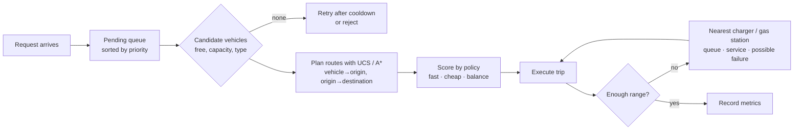
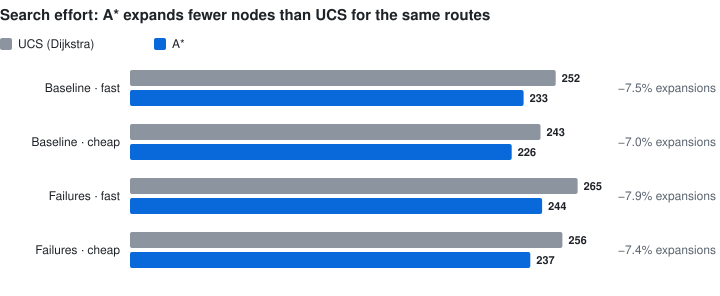
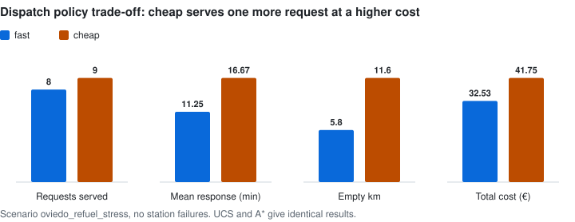

# TaxiGreen

[](https://github.com/larosenas/TaxiGreen/actions/workflows/tests.yml)


[](LICENSE)

**Discrete-event simulator for a mixed electric/combustion taxi fleet, with UCS and A\* route planning, pluggable dispatch policies, and charging stations that queue and fail.**

TaxiGreen models a city as a directed road graph (the sample scenarios use the city of Oviedo, Spain). Ride requests arrive over time; the simulator picks a vehicle for each one, plans its routes, sends it to recharge or refuel when its range is not enough, and records operational metrics such as response time, cost, CO₂, empty kilometres and how hard the search algorithm had to work.

It was built as a team project for an Artificial Intelligence course. The focus is on framing fleet dispatch as a search problem and measuring, empirically, what an informed search (A\*) buys over an uninformed one (UCS) inside a realistic, dynamic system.

## Highlights

- **Two route planners on a directed graph**: Uniform Cost Search (Dijkstra) and A\* with an admissible heuristic, both instrumented with search-effort counters (expansions, pops, pushes).
- **Event-driven engine**: time jumps to the next relevant event (a request arrives, a vehicle becomes free, a retry is due) instead of ticking minute by minute.
- **Mixed EV/ICE fleet** with per-vehicle range and consumption. Vehicles detour to the nearest reachable charger (EV) or gas station (ICE) when a leg is not feasible.
- **Stations with limited capacity**: parallel service slots, FIFO queues, service times.
- **Stochastic station failures** with a fixed seed, so every run is reproducible.
- **Four dispatch policies**: `fast`, `cheap`, `balance` and `nearest_origin`, plus request priorities, vehicle-type preferences, an "eco" preference that penalises combustion vehicles, deadlines and retry/cooldown logic.
- **Time-of-day traffic model** that scales travel times (rush hours, night, etc.).
- **Zero runtime dependencies**: the simulator is pure standard-library Python.

## Quick start

```bash
git clone https://github.com/larosenas/TaxiGreen.git
cd TaxiGreen

# Run one simulation (A* routing, cost-driven dispatch)
python run_sim.py --data data/oviedo_city --strategy astar --policy cheap --out out

# Same scenario with stations failing 10% of the time
python run_sim.py --data data/oviedo_city --fail-p 0.10 --fail-min 10 --fail-max 30 --out out_fail

# Run the test suite
python tests/run_tests.py
```

Commands are run from the repository root. Example output:

```text
== RESUMEN ==
{ "done": 10, "rejected": 2, "t_end": 91 }
Viajes=10  Km_vacio=22.50  Km_pasajero=22.60  CO2(kg)=3.51  Coste=67.59  Tresp_prom=21.00
```

Each run writes `metrics.json` (aggregate KPIs) and `trips.csv` (one row per served request) to the `--out` folder.

> The codebase, logs and metric names are in Spanish (e.g. `km_vacio` = empty km, `coste` = cost), as the project was developed at a Spanish university. All documentation is in English.

### Command-line options

| Flag                        | Values                                       | Default            | Description                                                     |
| --------------------------- | -------------------------------------------- | ------------------ | --------------------------------------------------------------- |
| `--data`                    | folder                                       | `data/oviedo_city` | Scenario folder                                                 |
| `--strategy`                | `ucs`, `astar`                               | `ucs`              | Route-planning algorithm                                        |
| `--policy`                  | `fast`, `cheap`, `balance`, `nearest_origin` | `fast`             | Dispatch policy                                                 |
| `--vehicles`                | file name                                    | `vehicles.json`    | Alternative fleet file inside the scenario folder               |
| `--max-retries`             | int                                          | `3`                | Attempts per request before rejecting it                        |
| `--cooldown-ticks`          | int                                          | `30`               | Simulated minutes to wait before retrying a request             |
| `--seed`                    | int                                          | `0`                | Random seed (station failures)                                  |
| `--fail-p`                  | float                                        | `0.0`              | Probability that a station fails when a vehicle tries to use it |
| `--fail-min` / `--fail-max` | int                                          | `10` / `30`        | Failure duration range, in minutes                              |
| `--out`                     | folder                                       | `out`              | Output folder                                                   |
| `--quiet`                   | flag                                         | off                | Suppress per-event logs                                         |

## How it works



**Routing.** Edge cost is travel time (`travel_min`). UCS is Dijkstra over time. A\* uses
`h(n) = hops_lb(n, goal) × min_edge_time`, where `hops_lb` is the minimum number of hops to the goal (BFS on the directed graph) and `min_edge_time` is the shortest edge travel time in the graph. Because no path can be shorter than that, the heuristic is admissible and A\* returns the same optimal routes as UCS.

**Dispatch.** For every eligible vehicle the engine estimates the time to reach the passenger, the trip time and a monetary cost (`km × €/km + minutes × €/min + energy × energy price`), then ranks candidates:

| Policy           | Minimises                                    |
| ---------------- | -------------------------------------------- |
| `fast`           | total time (vehicle→origin→destination)      |
| `nearest_origin` | time to reach the passenger, then total time |
| `cheap`          | estimated monetary cost, then total time     |
| `balance`        | `0.5 × total time + estimated cost`          |

**Energy and stations.** If a vehicle cannot complete a leg, it detours to the nearest reachable station of its type, waits for a free slot, gets served, and continues. With `--fail-p > 0`, a station may go down for a random period when a vehicle arrives, and vehicles wait until it recovers.

More detail in [docs/ARCHITECTURE.md](docs/ARCHITECTURE.md).

## Results

The experiments compare both search strategies and three dispatch policies on the `oviedo_refuel_stress` scenario (10 chained requests with tight energy margins), first without failures and then with stations failing (`fail_p = 0.5`, 10-minute outages).

**A\* finds the same routes with less work.** Operational results are identical for UCS and A\*, but A\* expands about 7–8% fewer nodes in every configuration:

<picture>
  <source media="(prefers-color-scheme: dark)" srcset="docs/img/search_effort_dark.svg">
  
</picture>

| Scenario         | Policy | UCS expansions | A\* expansions | Reduction |
| ---------------- | ------ | -------------: | -------------: | --------: |
| Baseline         | fast   |            252 |            233 |     −7.5% |
| Baseline         | cheap  |            243 |            226 |     −7.0% |
| Station failures | fast   |            265 |            244 |     −7.9% |
| Station failures | cheap  |            256 |            237 |     −7.4% |

**Dispatch policy is a real trade-off.** `cheap` serves one more request but drives twice as many empty kilometres, and responds more slowly:

<picture>
  <source media="(prefers-color-scheme: dark)" srcset="docs/img/policy_tradeoff_dark.svg">
  
</picture>

| Scenario         | Policy | Served | Rejected | Mean response (min) | Empty km | CO₂ (kg) | Cost (€) |
| ---------------- | ------ | -----: | -------: | ------------------: | -------: | -------: | -------: |
| Baseline         | fast   |      8 |        2 |               11.25 |      5.8 |     0.67 |    32.53 |
| Baseline         | cheap  |      9 |        1 |               16.67 |     11.6 |     0.82 |    41.75 |
| Station failures | fast   |      8 |        2 |               18.75 |      5.8 |     0.67 |    36.53 |
| Station failures | cheap  |      9 |        1 |               23.33 |     11.6 |     0.82 |    45.75 |

`balance` produced the same rankings as `fast` on this scenario. Station failures did not cost any requests, but they added 20 minutes of downtime waiting, raising mean response time by about 7 minutes and cost by €4.

The full write-up (problem formulation, method, discussion and limitations) is in [docs/REPORT.md](docs/REPORT.md).

### Reproducing the experiments

```bash
python tools/run_suite.py --data data/oviedo_refuel_stress --out out_suite/baseline --quiet \
  --seed 0 --fail-p 0 --strategies ucs,astar --policies fast,cheap,balance

python tools/run_suite.py --data data/oviedo_refuel_stress --out out_suite/fail --quiet \
  --seed 1 --fail-p 0.5 --fail-min 10 --fail-max 10 --strategies ucs,astar --policies fast,cheap,balance
```

Each run writes a `summary.csv` with every metric, and `python tools/make_svg_charts.py` rebuilds the charts above from them (no dependencies needed). If `pandas` and `matplotlib` are installed (`pip install -r requirements.txt`), bar charts are generated too. On Windows, `experiments/report/00_run_all.ps1` runs the whole pipeline. Set `$RUN_SEEDS = $true` in it to add a ten-seed robustness batch.

## Scenarios

Each scenario is a folder of JSON files (`nodes`, `edges`, `facilities`, `vehicles`, `requests` and an optional `cost_model`). JSON Schemas for every file live in [`schemas/`](schemas/).

| Scenario               | Nodes | Edges | Stations | Vehicles | Requests | Purpose                                                                |
| ---------------------- | ----: | ----: | -------: | -------: | -------: | ---------------------------------------------------------------------- |
| `oviedo_city`          |     6 |    10 |        4 |        2 |       12 | General case, includes an impossible request to exercise rejection     |
| `oviedo_city_directed` |     6 |    18 |        4 |        2 |       12 | Same city, with every street usable in both directions                 |
| `oviedo_refuel_easy`   |     6 |     9 |        4 |        2 |        3 | Low-energy vehicles that must charge or refuel first                   |
| `oviedo_refuel_stress` |     6 |     9 |        4 |        4 |       10 | Chained requests that force repeated refuelling                        |
| `demo_peticiones_ab`   |     6 |     5 |        2 |        2 |        3 | Minimal directed-graph demo (direct path, multi-hop path, unreachable) |

Some scenarios ship alternative fleets (`vehicles2.json`, `vehicles3.json`) selectable with `--vehicles`.

Validate a scenario:

```bash
python validate_data.py --data data/oviedo_city --schemas schemas
```

(full JSON Schema validation if `jsonschema` is installed, basic consistency checks otherwise).

## Project structure

```text
├── run_sim.py              # CLI entry point (event-driven engine)
├── validate_data.py        # Scenario validator
├── src/taxigreen/
│   ├── sim_evt/            # Event-driven engine: routing, dispatch, stations, metrics
│   ├── sim/                # Original tick-based engine (kept for the unit tests)
│   ├── classes/, io/, world.py  # Domain model and loaders used by the original engine
│   └── traffic.py          # Time-of-day traffic multiplier
├── data/                   # Scenarios
├── schemas/                # JSON Schemas for scenario files
├── tests/                  # Unit tests (no pytest required)
├── tools/                  # Experiment suite, SVG charts, legacy-engine sweep
├── experiments/report/     # PowerShell scripts that reproduce the report
└── docs/                   # Report, architecture notes and charts
```

## Tests

```bash
python tests/run_tests.py
```

The tests cover directed-graph pathfinding, dispatch policies, vehicle-type preferences, pricing, request deadlines, refuelling queues and loader error handling. CI runs them on Python 3.10–3.13 on every push.

## Authors

Developed as a group project for the Artificial Intelligence course by:

- **Laro Señas Gomez** ([@larosenas](https://github.com/larosenas))
- Javier Ibisate Corzo
- Pablo Barrero Cruz

## License

[MIT](LICENSE)
